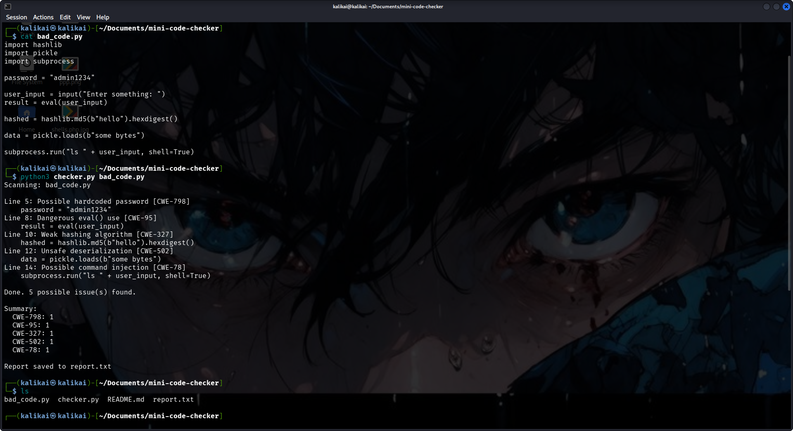
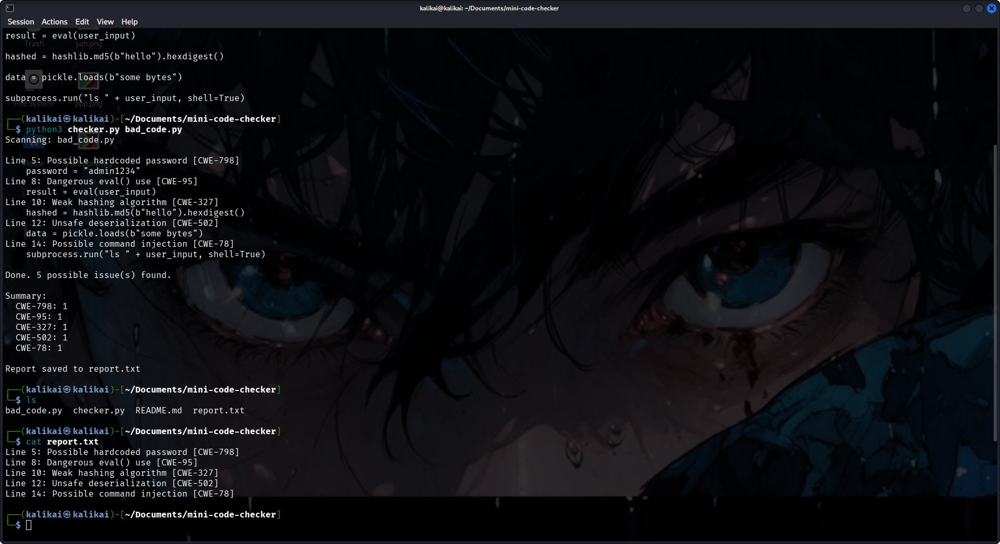

# Mini Code Checker

A beginner project that scans Python files for risky patterns
and labels each one with its CWE ID.

## What it detects
- `eval()` / `exec()` use (CWE-95)
- Unsafe `pickle.loads` deserialization (CWE-502)
- Weak hashing: MD5 / SHA1 (CWE-327)
- Hardcoded passwords / secrets (CWE-798)
- `shell=True` command injection risk (CWE-78)

## How to run
```
python3 checker.py bad_code.py
```
`bad_code.py` is a deliberately insecure test file. Never use that code for real.

The tool prints each finding with its line number, a summary count per CWE,
and saves the results to `report.txt`.

## Example output



## Files
- `checker.py`: the scanner
- `bad_code.py`: insecure sample code to test against
- `report.txt`: example report output

## Limitations
This tool uses simple text matching, so it can give false positives
(for example, a comment containing "md5") and can miss real issues.
It is a learning project, not a replacement for professional tools like
Bandit or Semgrep.

## What I learned
Python basics, file handling, dictionaries, command-line arguments,
and how the CWE system classifies common vulnerabilities.
Built and tested on Kali Linux.

